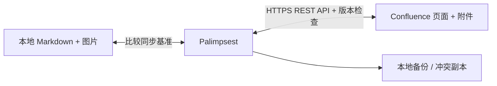

<div align="center">


# Palimpsest · 重写本

**Two shores. One manuscript.**

让本地 Markdown 与 Confluence，写下同一份故事。

[下载](../../releases/latest) · [快速开始](#快速开始) · [工作原理](#工作原理) · [参与贡献](CONTRIBUTING.md)


[](https://github.com/Pitayafruits/palimpsest/actions/workflows/ci.yml)
[](https://github.com/Pitayafruits/palimpsest/releases/latest)

</div>

---

需求文档在网页里，Agent 在本地写 Markdown。改完以后，复制、粘贴，再找一遍被改过的地方。

**Palimpsest 把这两端连起来。** 关联一个页面和一个文件，选择首次同步方向，然后让它在后台定期检查。网页点击更新，本地保存文件，另一端随之同步。

*Palimpsest，指被擦去旧字、再次书写的手稿。文字不断改写，故事始终相连。*

## 特性

| 能力 | 说明 |
| :--- | :--- |
| 双向同步 | 每 30 秒检查一次本地文件和网页版本；运行期间持续同步 |
| 自然关联 | 粘贴页面链接，选择 Markdown；自动维护一对一关系，可保存多个关联，每次运行一个 |
| 图片同行 | 下载 Confluence 附件图片到本地；上传 Markdown 引用的本地图片 |
| 冲突保护 | 两端同时修改时暂停，保留两份内容供人工处理 |
| 转换保护 | 不完整的格式转换会停止覆盖；复杂宏通过存储标记保留 |
| 登录记忆 | Windows 使用当前用户 DPAPI；macOS 使用系统钥匙串；支持退出账号 |
| 原生体验 | Windows WinForms，macOS Qt；页面链接一键打开默认浏览器 |
| 自有站点 | 首次启动填写 HTTPS 站点，支持 `/wiki` 等路径和非默认端口 |

## 下载

在 [Releases](../../releases/latest) 下载适合自己电脑的包，无需安装 Python。

| 系统 | 文件 | 使用方式 |
| :--- | :--- | :--- |
| Windows x64 | `Palimpsest-windows-x64.zip` | 完整解压，运行 `Palimpsest.exe`；保留旁边的 `engine` 文件夹 |
| macOS Apple Silicon | `Palimpsest-macos-arm64.dmg` | 将 `.app` 拖到 Applications |
| macOS Intel | `Palimpsest-macos-x64.dmg` | 将 `.app` 拖到 Applications |

Mac 同时提供 ZIP。每个平台附有 `SHA256SUMS` 校验文件。发行包尚未使用付费开发者证书签名，Mac 尚未公证，因此系统可能显示发行者验证提示。确认来源后按系统的应用打开流程处理。

## 快速开始

1. 打开应用，填写 Confluence 站点地址，例如 `https://wiki.example.com` 或 `https://wiki.example.com/wiki`。
2. 使用有页面编辑权限的账号登录。
3. 粘贴页面完整链接，选择本地 `.md` 文件。
4. 选择首次同步以本地或网页为准，确认内容后启动同步。
5. 保持应用运行。网页修改后点击“更新”，本地修改后保存文件。

首次同步会按选定方向更新目标端；建议先用测试页面体验。之后使用已有基准识别修改，首次方向不会反复覆盖内容。

### 图片与复杂格式

- 支持 PNG、JPEG、GIF、WebP、BMP，单张上限 50 MB。
- 网页附件图片保存到 Markdown 旁边的 `.assets` 目录。移动、备份或提交 Markdown 时请一起保留该目录。
- Markdown 中的相对路径图片会上传为页面附件；内容摘要用于减少重复上传。
- 外部网络图片不保证离线可用，也不会携带 Confluence 登录凭证跨站下载。
- Jira 卡片、复杂宏等无法直接表达的内容会以 `confluence-storage` 标记或原始格式保留。请保留这些标记；Markdown 预览不一定能显示宏的网页效果。

### 兼容范围

面向 **Confluence Server / Data Center 的 REST API 与用户名/密码 Basic Authentication**。目前不支持 Confluence Cloud 的邮箱/API Token 流程，也不提供浏览器 SSO、MFA、验证码自动登录。

同一站点的账号使用相同接口，但账号策略、权限、验证码锁定及 SSO 要求可能不同。遇到 401 或认证锁定，先在网页确认账号状态；403 请检查权限。网页能登录并不代表该账号允许 Basic Authentication。

## 工作原理



只改一端时，将修改同步到另一端；两端都改时停止自动覆盖。远端写入带版本号，本地写入前检查内容，并通过临时文件替换。它是同步工具，不负责自动合并同时修改的两份需求。

## 数据与隐私

应用直接连接你填写的 Confluence，没有中转服务或遥测。凭证不会写进关联配置或放到命令行参数。系统安全存储不可用时，不会退回明文保存。

| 系统 | 设置、基准、备份与状态目录 |
| :--- | :--- |
| Windows | `%LOCALAPPDATA%\Palimpsest` |
| macOS | `~/Library/Application Support/Palimpsest` |

同步基准、备份及冲突副本包含文档内容，保存在本机。退出登录会移除记住的凭证，文档和备份会保留。

高级配置：`PALIMPSEST_DATA` 可指定独立数据目录；`PALIMPSEST_SITE` 可指定 HTTPS 站点。切换站点请停止程序、退出账号，使用独立数据目录启动，避免混用关联记录。

## 开发与构建

需要 Python 3.12。请在 Windows 或 macOS 上构建对应平台的包。

```sh
python -m venv .venv
# 激活虚拟环境后：
python -m pip install -r requirements-build.txt
```

测试：

```sh
# macOS
PYTHONPATH=src QT_QPA_PLATFORM=offscreen python -m unittest discover -s tests -v
# Windows PowerShell
$env:PYTHONPATH="src"; $env:QT_QPA_PLATFORM="offscreen"
python -m unittest discover -s tests -v
```

```sh
python src/sync_engine.py --self-test
python scripts/build.py
```

Windows 构建需要 .NET Framework 4.x 的 C# 编译器；macOS 构建需要 Xcode Command Line Tools。输出在 `dist/release/`。Windows 使用原生 C# 界面和独立 Python 同步引擎；Mac 将 Qt 界面与同一引擎打包为 `.app`。Mac 开发时可执行 `python src/launch.py`。

GitHub Actions 在 Windows、Apple Silicon Mac 和 Intel Mac 上分别测试、构建。推送版本标签后，仅在三种构建全部成功时发布 Release。

## 项目结构

```text
src/                 共享同步引擎、图片处理、Mac 界面与钥匙串
windows/             Windows 界面、站点设置与凭证存储
tests/               格式转换、图片、冲突、登录及界面回归测试
scripts/build.py     原生构建、打包与校验和
.github/workflows/   测试与三平台发布
```

## 参与贡献

欢迎提交 Issue 或 Pull Request。请使用脱敏的最小示例说明问题，避免上传公司文档、附件、账号或日志中的敏感内容。详见 [贡献指南](CONTRIBUTING.md) 和 [安全说明](SECURITY.md)。

后续方向：更多登录方式、冲突比较界面、更多宏的可读转换，以及签名和公证。

## 许可证与致谢

项目自有代码采用 [MIT](LICENSE)。发行包包含具有各自许可证的第三方组件，尤其是 LGPLv3 的 PySide6/Qt；详见 [第三方说明](THIRD_PARTY_NOTICES.md) 及包内 `legal` 目录。

感谢 [lxml](https://lxml.de/)、[markdown-it-py](https://github.com/executablebooks/markdown-it-py)、[Qt for Python](https://www.qt.io/qt-for-python) 和 [PyInstaller](https://pyinstaller.org/)。

<div align="center"><sub>Keep the words in orbit.</sub></div>
